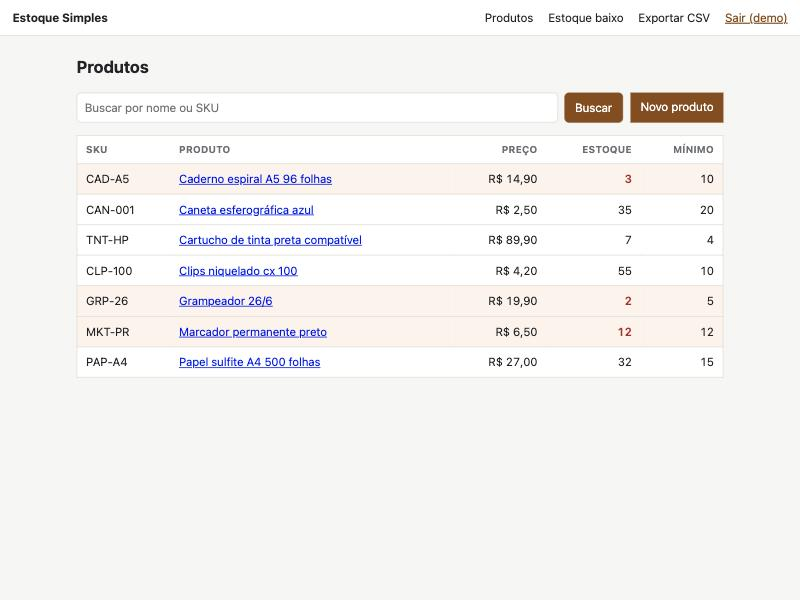

# Estoque Simples

Controle de estoque para pequeno comércio: cadastro de produtos, entradas e saídas, alerta de estoque baixo e exportação para planilha. Aplicação tradicional renderizada no servidor (Flask + Jinja), sem JavaScript no front.



## O que faz

- Login com usuários criados por linha de comando
- Cadastro de produto (SKU, nome, preço, estoque mínimo) e busca por nome ou SKU
- Entradas e saídas com observação e registro de quem fez
- Saída maior que o saldo é recusada
- Lista destaca em vermelho o que está no mínimo ou abaixo; o relatório "Estoque baixo" mostra quanto repor
- Exporta CSV (`;` como separador e BOM, para o Excel abrir com acentos)

## Decisões

**Saldo calculado, não armazenado.** O estoque de um produto é a soma das movimentações, não uma coluna que se atualiza. Assim o histórico sempre explica o número e não existe saldo "dessincronizado".

**Saída dentro de transação travada.** A rota lê o saldo e grava a saída sob `BEGIN IMMEDIATE`. Sem isso, duas saídas simultâneas poderiam ler o mesmo saldo e as duas passariam, deixando o estoque negativo. Há um teste para o caso de saída maior que o saldo.

**SQL direto, sem ORM.** O projeto é pequeno e as consultas são poucas. Escrever o `JOIN` com `SUM(CASE ...)` à mão mostra o que está acontecendo.

**Dinheiro em centavos** (inteiro). Entrada aceita `1.234,56`, `12,50` ou `7`.

### Segurança

Foi a parte em que mais mexi, porque aplicação com login e formulário tem muita coisa que sai errado em silêncio:

- **CSRF** em toda requisição que altera estado, com token por sessão comparado em tempo constante. Implementado à mão (`app/security.py`) em vez de importar uma extensão, para deixar claro o mecanismo.
- **Sessão nova após o login** (`session.clear()`), contra session fixation. Cookie `HttpOnly` e `SameSite=Lax`.
- **`next` do login só aceita caminho interno.** `https://evil`, `//evil` e `/\evil` caem na home (testado).
- **Injeção de fórmula em CSV.** Um produto chamado `=HYPERLINK(...)` viraria fórmula ao abrir o arquivo no Excel. Células que começam com `=`, `+`, `-` ou `@` recebem um apóstrofo na exportação.
- **XSS:** o Jinja escapa tudo por padrão, e há um teste com `<script>` no nome do produto. Além disso, `Content-Security-Policy: default-src 'self'` (o que também me fez tirar um `style` inline que eu tinha deixado).
- **Busca:** `%` e `_` digitados pelo usuário são tratados como texto, não como curinga do `LIKE`.
- Senhas com scrypt. Alguns Pythons não têm `hashlib.scrypt` (o da Apple, por exemplo); nesse caso cai para PBKDF2.

## Rodando

Python 3.9 ou mais novo.

```bash
python -m venv .venv
source .venv/bin/activate
pip install -r requirements-dev.txt

export SECRET_KEY=$(python -c "import secrets; print(secrets.token_hex(32))")
flask --app app create-user maria      # pede a senha
flask --app app run
```

Abra http://localhost:5000. O banco é criado em `./estoque.db` (mude com `DATABASE`).

## Testes

```bash
pytest
```

São 27 testes, em 3 segundos. Os da aplicação usam o cliente de teste do Flask, com um wrapper pequeno que cuida do token CSRF.

## Limitações

- Não há edição nem exclusão de produto, só cadastro e movimentação.
- Sem perfis de usuário: quem entra pode tudo.
- Sem limite de tentativas no login.
- O histórico mostra as 50 últimas movimentações, sem paginação.
- Para produção, `flask run` não serve: use gunicorn ou similar atrás de HTTPS e defina `SESSION_COOKIE_SECURE=True`.

## Licença

MIT
